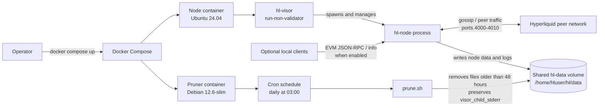

# Architecture Overview

This repository packages a Hyperliquid non-validator node and a companion data-pruning service with Docker Compose.

## Components and data flow

- **Node container:** The root `Dockerfile` downloads the `hl-visor` binary and its signature, verifies the signature with the repository's public key, and configures Testnet by default. The visor runs a non-validator node and manages its child node process.
- **Peer connectivity:** Docker Compose maps ports `4000-4010` to the host for node networking. The README calls out ports `4001` and `4002` as gossip ports that must be publicly reachable for peer prioritization.
- **Persistent data:** Both services mount the same Compose-managed `hl-data` volume at `/home/hluser/hl/data`. The node writes its data there; the pruner operates on those files.
- **Pruner container:** Cron invokes the pruning script daily at 03:00. It deletes files older than 48 hours, excluding the `visor_child_stderr` directory, and reports size and file-count information to container output.
- **Optional APIs:** The node can serve EVM JSON-RPC and local info requests when started with the corresponding flags. These services are optional and are not enabled by the Compose configuration shown in this repository.

## Deployment configuration

The Compose file defines the `node` and `pruner` services and a local named volume. The node service publishes ports `4000-4010`; the pruner requires access to the same volume so it can clean up node output.
